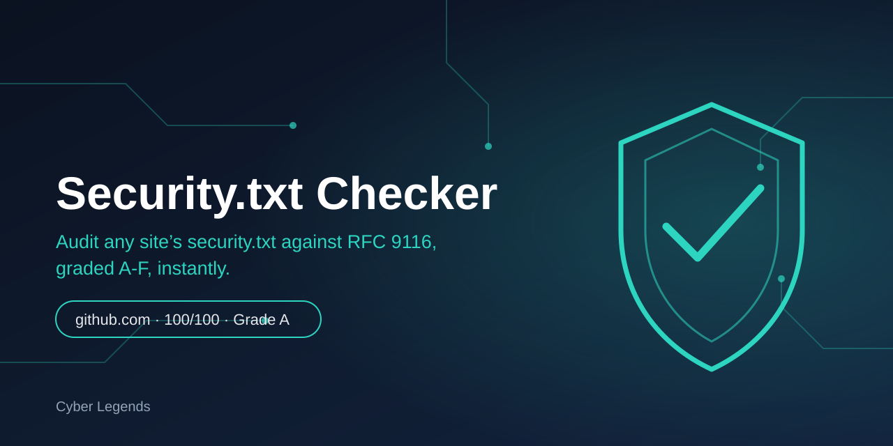
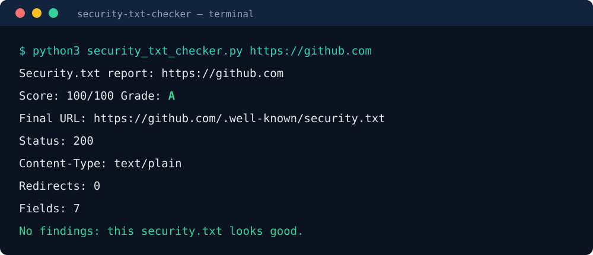
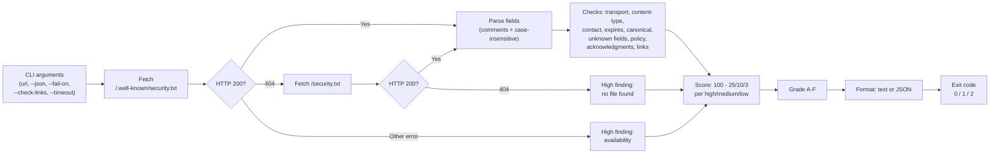

<p align="center">
  
</p>

<h1 align="center">Security.txt Checker</h1>

<p align="center"><strong>Audit any site's security.txt against RFC 9116, graded A-F, instantly.</strong></p>

<p align="center">
  <a href="LICENSE"></a>
  <a href="https://github.com/sajidhussainraza/security-txt-checker/releases"></a>
  <a href="https://github.com/sajidhussainraza/security-txt-checker/stargazers"></a>
  <a href="https://github.com/sajidhussainraza/security-txt-checker/network/members"></a>
  <a href="https://github.com/sajidhussainraza/security-txt-checker/issues"></a>
  <a href="https://github.com/sajidhussainraza/security-txt-checker/commits/main"></a>
  <a href="https://github.com/sajidhussainraza/security-txt-checker/actions/workflows/ci.yml"></a>
  <a href="https://github.com/sajidhussainraza/security-txt-checker"></a>
  <a href="CONTRIBUTING.md"></a>
</p>

<p align="center">
  <a href="#demo">Demo</a> |
  <a href="#usage">Docs</a> |
  <a href="#installation">Install</a> |
  <a href="https://github.com/sajidhussainraza/security-txt-checker/issues/new?template=bug_report.yml">Report Bug</a> |
  <a href="https://github.com/sajidhussainraza/security-txt-checker/issues/new?template=feature_request.yml">Request Feature</a>
</p>

## Why this exists

**Problem:** a security researcher who finds a flaw needs a safe place to report it, but many sites have no `security.txt` file, or a stale one pointing at a dead inbox — so reports go public, or never arrive at all.
**Solution:** one command audits the file against RFC 9116, grades it A-F, and explains every finding in plain language with a concrete fix.
**Result:** sites publish correct contact details, and researchers report vulnerabilities privately instead of disclosing them in public.

## Demo



*Static preview of the real terminal output (auditing github.com on 20 November 2026). No recorded GIF exists yet — a recording script is provided at [`assets/demo.tape`](assets/demo.tape) (VHS, terminal 100x28, dark theme, under 15 seconds) and a real `demo.gif` is on the [roadmap](#roadmap).*

## Features

- 🚀 **Zero dependencies** — Python standard library only. Clone and run; nothing to install, nothing to update.
- 🎓 **A-F grading** — a 0-100 score with a clear grade, so a site's vulnerability disclosure readiness is obvious at a glance.
- 💬 **Plain-language findings** — every finding comes with a concrete fix, not just an error code.
- 📜 **Full RFC 9116 coverage** — Contact, Expires, Canonical, Content-Type, HTTPS transport, unknown or typo'd fields, and optional Policy and Acknowledgments.
- 🔗 **Optional link checking** — `--check-links` verifies the URLs inside the file actually answer.
- 🤖 **CI-ready** — `--json` for machine-readable output and `--fail-on` to fail a build on findings above a severity you choose.
- 🔒 **Private by design** — no telemetry, nothing stored. It only sends read-only GET requests and never logs in or submits data.
- ✅ **Tested** — 17 tests, including mock-server tests and a live audit of github.com.

## Table of contents

- [Why this exists](#why-this-exists)
- [Demo](#demo)
- [Features](#features)
- [Quick start](#quick-start)
- [Installation](#installation)
- [Usage](#usage)
- [CLI reference](#cli-reference)
- [Configuration](#configuration)
- [How scoring works](#how-scoring-works)
- [What it checks](#what-it-checks)
- [Examples](#examples)
- [Architecture](#architecture)
- [Project structure](#project-structure)
- [Comparison with alternatives](#comparison-with-alternatives)
- [FAQ](#faq)
- [Tests](#tests)
- [Roadmap](#roadmap)
- [Contributing](#contributing)
- [License](#license)
- [Acknowledgements](#acknowledgements)

## Quick start

Get a working result in under 60 seconds — three commands, no setup:

```bash
git clone https://github.com/sajidhussainraza/security-txt-checker.git
cd security-txt-checker
python3 security_txt_checker.py https://github.com
```

```
Security.txt report: https://github.com
Score: 100/100  Grade: A

  Final URL: https://github.com/.well-known/security.txt
  Status: 200
  Content-Type: text/plain
  Redirects: 0
  Fields: 7

No findings: this security.txt looks good.
```

## Installation

### Prerequisites

| Requirement | Version | Notes |
| --- | --- | --- |
| Python | 3.8 or later | Standard library only — no `pip install` needed |
| Git | Any recent version | Only to clone the repository |
| Internet access | — | The tool fetches the target site's public `security.txt` |

### Windows

```powershell
git clone https://github.com/sajidhussainraza/security-txt-checker.git
cd security-txt-checker
py security_txt_checker.py https://github.com
```

On Windows use `py` (or `python`) instead of `python3`. If `py` is not
found, install Python from [python.org](https://www.python.org/downloads/)
and tick "Add Python to PATH" during setup.

### macOS

```bash
git clone https://github.com/sajidhussainraza/security-txt-checker.git
cd security-txt-checker
python3 security_txt_checker.py https://github.com
```

macOS ships a `python3` (3.9 or later on recent versions). If it is
missing, install Python from [python.org](https://www.python.org/downloads/)
or with `brew install python`.

### Linux

```bash
git clone https://github.com/sajidhussainraza/security-txt-checker.git
cd security-txt-checker
python3 security_txt_checker.py https://github.com
```

Python 3.8+ is preinstalled on most distributions. On minimal installs,
use your package manager, e.g. `sudo apt install python3 git` (Debian/Ubuntu).

### Install from source

There is no package to install: the tool is a single file,
`security_txt_checker.py`, with no dependencies. Cloning the repository
*is* the install. (PyPI packaging is on the [roadmap](#roadmap).)

### Verify the install

```bash
python3 security_txt_checker.py https://github.com
```

You should see `Score: 100/100  Grade: A` and
`No findings: this security.txt looks good.` If you see that, the tool
works.

### Troubleshooting

| Error / symptom | Cause | Fix |
| --- | --- | --- |
| `Error: URL must start with http:// or https://` | URL given without a scheme | Add `https://`, e.g. `https://example.com` (exit code 2) |
| `Could not reach the site` | Site offline, wrong host, or no network | Check the URL and your connection (exit code 2) |
| `python3: command not found` (Windows) | `python3` is not on PATH | Use `py security_txt_checker.py ...` instead |
| `SSL: CERTIFICATE_VERIFY_FAILED` | System clock wrong or missing CA certificates | Fix the clock; update CA certificates for your OS |
| Live test skipped when running tests | No network in the test environment | Expected: the live test skips automatically; the 16 mock-server tests still run |
| `Score: 75/100 Grade: B` on a site you own | No `security.txt` published yet | Publish one at `/.well-known/security.txt` — see the [FAQ](#faq) |

## Usage

### Basic: audit a website

```bash
python3 security_txt_checker.py https://github.com
```

```
Security.txt report: https://github.com
Score: 100/100  Grade: A

  Final URL: https://github.com/.well-known/security.txt
  Status: 200
  Content-Type: text/plain
  Redirects: 0
  Fields: 7

No findings: this security.txt looks good.
```

### Intermediate: check the links inside the file, and get JSON

Verify the URLs in Encryption, Policy, Acknowledgments and Hiring
actually answer:

```bash
python3 security_txt_checker.py https://example.com --check-links
```

Machine-readable output for scripts and dashboards:

```bash
python3 security_txt_checker.py https://example.com --json
```

```json
{
  "url": "https://example.com",
  "final_url": "https://example.com/.well-known/security.txt",
  "status": 404,
  "content_type": null,
  "redirects": 0,
  "field_count": 0,
  "findings": [
    {
      "severity": "high",
      "field": "availability",
      "message": "No security.txt found at /.well-known/security.txt or /security.txt (both returned 404).",
      "fix": "Publish a security.txt at /.well-known/security.txt so researchers have a safe way to report vulnerabilities."
    }
  ],
  "score": 75,
  "grade": "B"
}
```

### Advanced: use it as a CI gate

Fail the build only on high-severity findings (exit code 1 when such a
finding exists, 0 otherwise):

```bash
python3 security_txt_checker.py https://example.com --fail-on high
echo "exit=$?"
```

```
Security.txt report: https://example.com
Score: 75/100  Grade: B
...
Findings (1):
  [HIGH] availability: No security.txt found at
  /.well-known/security.txt or /security.txt (both returned 404).
        Fix: Publish a security.txt at /.well-known/security.txt so
        researchers have a safe way to report vulnerabilities.
exit=1
```

In a GitHub Actions workflow (after checking out this repository):

```yaml
- name: Audit our security.txt
  run: python3 security_txt_checker.py https://example.com --fail-on high
```

You can also use the checker as a Python library — `check_security_txt()`
returns the same report dict the `--json` flag prints:

```python
from security_txt_checker import check_security_txt

report = check_security_txt("https://github.com")
print(report["score"], report["grade"])  # 100 A
```

## CLI reference

| Flag | Description |
| --- | --- |
| `url` | Website URL to audit, e.g. `https://example.com` |
| `--json` | Print the report as JSON instead of text |
| `--fail-on {high, medium, low, none}` | Exit 1 when a finding of this severity or worse exists (default: `none`) |
| `--check-links` | Also verify the URLs in Encryption, Policy, Acknowledgments and Hiring answer |
| `--timeout SECONDS` | Request timeout in seconds (default: 10) |
| `--help` | Show usage and exit |

### Exit codes

| Code | Meaning |
| --- | --- |
| 0 | No findings at or above `--fail-on` |
| 1 | Findings at or above `--fail-on` were found |
| 2 | Usage error (bad URL, site unreachable) |

## Configuration

There is no config file: everything is a command-line flag.

| Option | Type | Default | Description |
| --- | --- | --- | --- |
| `url` | string | — (required) | Website URL to audit; must start with `http://` or `https://` |
| `--json` | flag | off | Print the report as JSON |
| `--fail-on` | `high` / `medium` / `low` / `none` | `none` | Severity threshold that makes the exit code 1 |
| `--check-links` | flag | off | HEAD-check the URLs in optional fields |
| `--timeout` | integer (seconds) | `10` | Request timeout for fetching the file and links |

## How scoring works

The score starts at 100 and deducts **25** per high-severity finding,
**10** per medium, and **3** per low:

| Score | Grade |
| --- | --- |
| 90-100 | A |
| 75-89 | B |
| 60-74 | C |
| 40-59 | D |
| 0-39 | F |

Findings are graded by severity:

| Severity | Examples |
| --- | --- |
| High | No security.txt at all, served over plain HTTP, no Contact, Expires in the past |
| Medium | Invalid Contact URI, missing or malformed Expires, Canonical mismatch |
| Low | Wrong Content-Type, unknown field, missing Policy or Acknowledgments, Expires more than a year away, broken optional link |

## What it checks

| Check | What a good result looks like |
| --- | --- |
| Availability | A file exists at `/.well-known/security.txt` (or `/security.txt`) and returns HTTP 200 |
| Transport | The file is served over HTTPS, so it cannot be altered in transit |
| Content-Type | Served as `text/plain` |
| Contact | At least one Contact, as a valid `mailto:`, `https:` or `tel:` URI |
| Expires | Present, a valid RFC 3339 date-time, in the future and no more than a year away |
| Canonical | Matches the exact URL the file was fetched from |
| Fields | No unknown or misspelled fields (e.g. `Contract:` instead of `Contact:`) |
| Policy / Acknowledgments | Present, so researchers can see the disclosure rules and how past reports were credited |
| Links (`--check-links`) | The URLs in Encryption, Policy, Acknowledgments and Hiring actually answer |

## Examples

Google scores 97/100: its only finding is a low-severity one, an Expires
date more than a year away (2030-04-01). A long-lived file is easy to
forget and leave stale, so the checker nudges it to renew yearly. The
full output of the GitHub and Google runs is saved in
`examples/sample-output-github.com.txt` and
`examples/sample-output-google.com.txt` (captured 18 November 2026).

A site with no security.txt at all gets one high finding:

```
$ python3 security_txt_checker.py https://example.com
Security.txt report: https://example.com
Score: 75/100  Grade: B

  Final URL: https://example.com/.well-known/security.txt
  Status: 404
  Content-Type: None
  Redirects: 0
  Fields: 0

Findings (1):
  [HIGH] availability: No security.txt found at
  /.well-known/security.txt or /security.txt (both returned 404).
        Fix: Publish a security.txt at /.well-known/security.txt so
        researchers have a safe way to report vulnerabilities.
```

| Site | Score | Grade |
| --- | --- | --- |
| github.com | 100/100 | A |
| google.com | 97/100 | A |
| example.com | 75/100 | B (no file) |

Scores verified live on 20 November 2026.

### Teaching notes

This tool pairs well with a lesson on coordinated vulnerability
disclosure: run it against a deliberately bare demo site, then add one
field at a time and watch the grade move. Good discussion points:

- Why a missing security.txt is a security problem: a researcher who
  finds a flaw and has nowhere safe to report it either stays silent,
  reports it in public, or sells it.
- Why Expires matters: a stale file points researchers at a dead inbox,
  so the date is a promise the file is still maintained.
- Why Canonical matters: without it, a copied file on a mirror or a
  typo-squat domain looks just as official as the real one.
- Why the Contact must be a full URI: `security@example.com` on its own
  is ambiguous, while `mailto:security@example.com` tells every tool
  exactly what to do with it.
- Why HTTPS matters for a plain text file: over HTTP, anyone on the path
  can swap in their own contact address and collect the reports.

Note: the checker only reads the public security.txt file. It cannot
audit a file that requires login, and it does not test whether the
contact address actually responds to a report; that needs a human to
send a test message.

## Architecture



The whole tool is one file (`security_txt_checker.py`, standard library
only): `fetch()` retrieves the file, `parse_security_txt()` turns it into
fields, `check_security_txt()` runs every check and returns a report
dict, and `format_text()` / `json.dumps()` render it. `main()` wires up
`argparse` and maps the result to the exit code.

## Project structure

```
security-txt-checker/
├── .github/
│   ├── ISSUE_TEMPLATE/
│   │   ├── bug_report.yml        # Bug report form
│   │   ├── feature_request.yml   # Feature request form
│   │   └── config.yml            # Issue template settings + contact links
│   ├── PULL_REQUEST_TEMPLATE.md  # PR checklist
│   └── workflows/
│       └── ci.yml                # Tests on Python 3.8-3.13, Ubuntu/macOS/Windows
├── assets/
│   ├── banner.svg                # README hero banner (1280x640)
│   ├── demo.svg                  # Static preview of real terminal output
│   ├── demo.tape                 # VHS script to record a real demo.gif
│   ├── logo.svg                  # Square logo (works at 64px)
│   ├── README.md                 # Asset notes, palette, contrast ratios
│   └── social-preview.png        # Social preview (PNG: upload via web UI)
├── docs/
│   └── banner.png                # PNG banner (upload via web UI)
├── examples/
│   ├── sample-output-github.com.txt   # Full output: github.com, 100/100 A
│   └── sample-output-google.com.txt   # Full output: google.com, 97/100 A
├── tests/
│   ├── run_tests.py              # Test runner (unittest)
│   └── test_security_txt_checker.py  # 17 tests: mock server + live audit
├── .editorconfig                 # Editor settings
├── .gitignore                    # Python / editor ignores
├── CHANGELOG.md                  # Keep a Changelog, SemVer
├── CODE_OF_CONDUCT.md            # Contributor Covenant 2.1
├── CONTRIBUTING.md               # How to contribute
├── LICENSE                       # MIT
├── README.md                     # This file
├── SECURITY.md                   # How to report a vulnerability
└── security_txt_checker.py       # The tool: dependency-free CLI
```

PNG files (`assets/social-preview.png`, `docs/banner.png`) cannot be
pushed through the GitHub connector used for this repository (it accepts
UTF-8 text snapshots only); they are uploaded via the GitHub web UI.
See [`assets/README.md`](assets/README.md).

## Comparison with alternatives

Skipped: no competing tools were specified for this project, so there is
no comparison table. If you know a comparable security.txt auditor, open
a [feature request](https://github.com/sajidhussainraza/security-txt-checker/issues/new?template=feature_request.yml)
and one can be added with verified facts only.

## FAQ

**What is security.txt?**
A small text file a website publishes at `/.well-known/security.txt`
([RFC 9116](https://www.rfc-editor.org/rfc/rfc9116)) that tells security
researchers how to report a vulnerability: who to contact, the
disclosure policy, and when the file expires.

**What does the grade mean?**
The score starts at 100 and loses 25 points per high-severity finding,
10 per medium, and 3 per low. 90+ is A, 75+ B, 60+ C, 40+ D, below that
F. A site with no file at all scores 75 (B) from the single high
finding — the grade measures the file, not the site's overall security.

**Why does google.com score 97/100?**
Its only finding is low severity: its Expires date (2030-04-01) is more
than a year away. A long-lived file is easy to forget and leave stale,
so the checker nudges it to renew yearly.

**Does the checker send my data anywhere?**
No. It only sends read-only GET requests to the site you name (plus HEAD
requests to the file's own links if you pass `--check-links`). No
telemetry, nothing stored, no login.

**Can I use it in CI?**
Yes — see [Advanced usage](#advanced-use-it-as-a-ci-gate). Run with
`--fail-on high` (or `medium` / `low`) and the exit code fails the build
when a finding at that severity or worse exists. `--json` gives
machine-readable output for dashboards.

**Does it check whether the contact address actually works?**
No. It checks that a Contact exists and is a valid `mailto:`, `https:`
or `tel:` URI. Whether the inbox is monitored needs a human to send a
test message.

**What Python versions are supported?**
Python 3.8 and later, on Windows, macOS, and Linux. There are no
third-party dependencies, and CI tests Python 3.8 through 3.13.

**I got "No security.txt found" — what should I publish?**
A minimal valid file at `/.well-known/security.txt`:

```
Contact: mailto:security@example.com
Expires: 2027-06-01T00:00:00Z
```

Then add Policy, Acknowledgments, and Canonical to reach 100/100.
Replace the address and date with your own, and renew Expires at least
yearly.

## Tests

```bash
python3 tests/run_tests.py   # 17 tests, including a live audit of github.com
```

The mock-server tests run a local fake site serving good, expired,
contact-less and mistyped security.txt variants, so they need no
internet. The live test runs a real audit against github.com and is
skipped automatically when the network is unreachable. (pytest is also
supported if it is installed: `python3 -m pytest tests/ -q`.)

## Roadmap

- [ ] Record a real demo GIF from `assets/demo.tape` and reference it in the README
- [ ] Upload the PNG banner and social preview via the GitHub web UI
- [ ] Fix redirect counting (urllib follows redirects automatically, so `Redirects` currently reports 0 even after a redirect)
- [ ] PyPI packaging (`pip install security-txt-checker`)
- [ ] SARIF output for GitHub code scanning
- [ ] Validate `Preferred-Languages` values against known language tags
- [ ] Pre-commit hook example
- [ ] Create the v1.0.0 GitHub release

## Contributing

Contributions are welcome — see [CONTRIBUTING.md](CONTRIBUTING.md) for
the full guide. In short:

1. Fork the repository and create a branch for your change.
2. Keep the tool dependency-free (standard library only).
3. Add or update tests in `tests/` for any new check or behaviour.
4. Run `python3 tests/run_tests.py` and make sure all 17 tests pass.
5. Open a pull request describing what changed and why.

Please also read the [Code of Conduct](CODE_OF_CONDUCT.md), and report
security vulnerabilities privately as described in
[SECURITY.md](SECURITY.md) — never in a public issue.

## License

MIT — see [LICENSE](LICENSE).

## Acknowledgements

- The authors and editors of [RFC 9116](https://www.rfc-editor.org/rfc/rfc9116),
  the standard this tool audits against.
- The [Contributor Covenant](https://www.contributor-covenant.org/) for
  the Code of Conduct text.
- [Keep a Changelog](https://keepachangelog.com/) and
  [Semantic Versioning](https://semver.org/) for the changelog format.
- Built by [Cyber Legends](https://cyberlegends.org) — cybersecurity
  trainings, services and solutions.

## Star history

[](https://star-history.com/#sajidhussainraza/security-txt-checker&Date)

## Contributors

[](https://github.com/sajidhussainraza/security-txt-checker/graphs/contributors)

---

**If this saved you time, please star the repo.** ⭐
